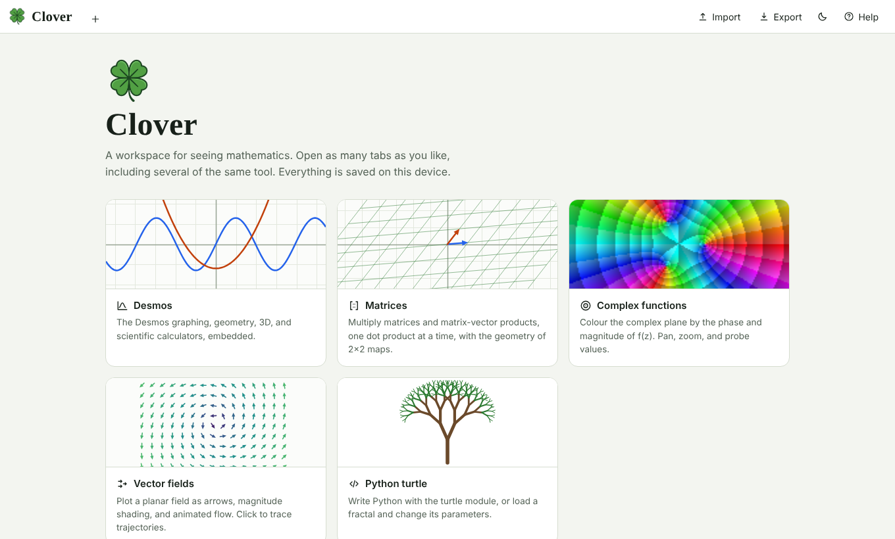
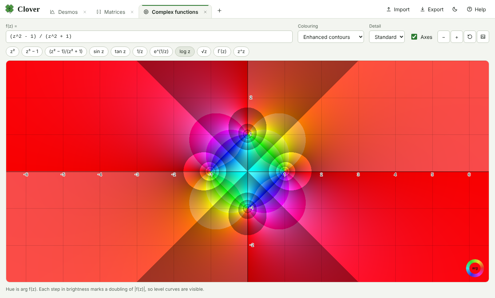
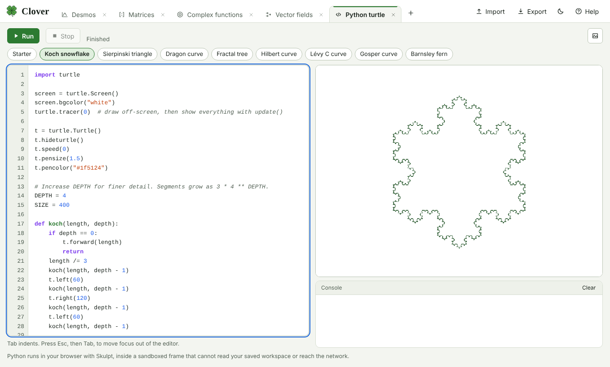

# Clover

A browser workspace for visualising mathematics. Open as many tabs as you like, including several of the same tool, and share your work as a single file.

https://hyrumhendrickson.github.io/Clover/



## Tools

| Tool                  | What it does                                                                                                                                                                                  |
| --------------------- | --------------------------------------------------------------------------------------------------------------------------------------------------------------------------------------------- |
| **Graphing**          | A built-in 2D graphing calculator: functions, equations, inequalities, polar and parametric curves, points and lists, sliders, tables, folders, regressions, and click-to-inspect intercepts. |
| **Statistics**        | Data columns with summaries and charts, regression, probability distributions, and significance tests.                                                                                        |
| **Matrices**          | Matrix × matrix and matrix × vector, one dot product at a time. For 2×2 maps it draws the transformed grid, unit square, and basis vectors. Drag the vector tip.                              |
| **Complex functions** | Domain colouring of any f(z). Three colourings, pan and zoom, a value probe, and PNG export.                                                                                                  |
| **Vector fields**     | Plot F = ⟨P, Q⟩ as arrows, magnitude shading, and animated flow. Click to trace trajectories. Divergence and curl are shown under the cursor.                                                 |
| **3D graphing**       | Surfaces, implicit surfaces, space curves, parametric surfaces, and points. Orbit, pan, and zoom.                                                                                             |
| **Notebook**          | Text, math, and graph cells in one document, sharing definitions.                                                                                                                             |
| **Fractals**          | Mandelbrot, Julia, Burning Ship, tricorn, and Newton fractals with pan and zoom.                                                                                                              |
| **Cellular automata** | Rules written in Python with any number of colours. Click to paint; play, pause, step, and step back. Includes Life and a forest fire.                                                        |
| **LaTeX**             | Several files and pictures, source beside the PDF. TeX Live runs in WebAssembly in a sandboxed frame.                                                                                         |
| **Symbolic algebra**  | Maxima syntax: expand, differentiate, integrate, solve. A built-in engine, not the full Maxima program.                                                                                       |
| **Programming**       | Write and run Python, Rust, C, C++, or Java with standard input and output. Runs on a remote Judge0 service.                                                                                  |
| **Python turtle**     | Python with the `turtle` module, run in the browser. Presets for Koch, Sierpinski, dragon, tree, Hilbert, Lévy, Gosper, and Barnsley fern.                                                    |




## Saving and sharing

- Work is saved automatically in your browser's local storage. Nothing is sent to a server, with one exception: pressing Run in the Programming tab sends that program and its input to a code execution service (see [docs/programming.md](docs/programming.md)).
- **Export** writes the whole workspace or one tab to a `.clover` file. A recipient opens it with **Import** or by dropping it on the page and sees what you saw. See [docs/file-format.md](docs/file-format.md).
- Graphs are saved as their expressions, so a shared file reproduces the whole graph. Files from version 1 that held a Desmos link open as an empty graph with the link kept as a note.

## Embedding

Show all of Clover, or one tool, on another website with an iframe or the `<clover-embed>` element. See [docs/embedding.md](docs/embedding.md).

```html
<iframe
  src="https://hyrumhendrickson.github.io/Clover/?embed=1&tool=matrix"
  width="100%"
  height="600"
  style="border: 0"
></iframe>
```

## Run locally

Clover is a static site with no build step. ES modules do not load from `file://`, so serve the folder:

```sh
npm start            # http://localhost:8080
# or
python3 -m http.server 8080
```

## Develop

```sh
npm install
npm run check        # lint, format check, tests
npm test
npm run verify:vendor
```

Tests cover the expression parser, complex math, domain colouring, field numerics, import validation, every Python preset (run through the real Skulpt build), and UI smoke tests in jsdom. See [AGENTS.md](AGENTS.md) for conventions and [docs/architecture.md](docs/architecture.md) for the design.

## Deploy

Push to `main`. The Pages workflow in `.github/workflows/pages.yml` publishes the site. Enable it under **Settings → Pages → Source: GitHub Actions**.

## Security

Shared files are treated as untrusted data. Python runs in a sandboxed iframe with no access to your saved workspace or the network, and only when you press Run, Play, or Step. The LaTeX compiler runs in its own sandboxed frame with no access to your workspace; it downloads TeX packages when a document needs them. See [SECURITY.md](SECURITY.md).

## Third-party software

[Skulpt](https://github.com/skulpt/skulpt) (MIT) is vendored in `vendor/skulpt`, and the [Siglum](https://github.com/SiglumProject/siglum) TeX engine (MIT) in `vendor/siglum`. See [THIRD_PARTY_NOTICES.md](THIRD_PARTY_NOTICES.md). The graphing tool is original code. Its input syntax follows Desmos conventions where practical; Clover is not affiliated with Desmos Studio PBC. See [docs/graphing.md](docs/graphing.md) for the full syntax.

## License

[GNU General Public License, version 2](LICENSE), the same license as [Maxima](https://maxima.sourceforge.io/). Earlier releases were published under the MIT license.
